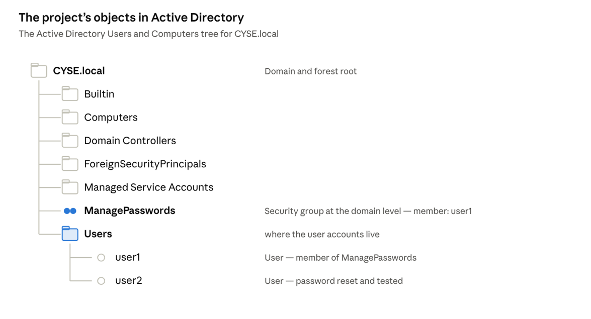

# Active Directory Lab

A team project where we built a Windows Server 2022 domain controller from scratch (CYSE.local) and practiced managing users, groups, and password resets in Active Directory.

## Assignment design
The project was built around a contractor-management scenario: create accounts, organize them in organizational units, protect and delegate control of an admin account, and manage password resets.

**Structure**

**Workflow**

The workflow covers:
- Creating a first user, then cloning it to make two more
- Moving the clones into separate organizational units
- Creating a Universal admin group and adding the first user to it
- Adding the first user to the Protected Users group
- Delegating password-reset control to the first user
- Resetting one account's password, disabling another, and verifying the City attribute

## My lab environment
This is the Active Directory Users and Computers tree from my own CYSE.local domain. The assignment's CONTRACTOR accounts map to the user accounts below.

- **ManagePasswords:** security group at the domain level, with user1 as a member
- **user1:** member of ManagePasswords, delegated to manage accounts and reset passwords
- **user2:** password reset with forced change at next login, then tested by signing in as CYSE\user2

## Setup steps
1. Set up the hypervisor (VMware Workstation, or UTM on Mac) and download the Windows Server 2022 evaluation ISO
2. Create the virtual machine and install Windows Server 2022
3. Install Active Directory Domain Services and promote the server to a domain controller
4. Create the group, delegate control, and create the users
5. Reset the second user's password and verify the login

## Why Active Directory matters in security
Active Directory manages user accounts across a whole organization, so it is a common target in attacks. Related MITRE ATT&CK techniques:
- T1078 Valid Accounts
- T1136 Create Account
- T1484 Domain Policy Modification

Defenders can watch Windows Event IDs such as 4720 (account created), 4728/4732/4756 (member added to a group), 4625 (failed logon), and 4688 (process creation).

## Tools
VMware Workstation, Windows Server 2022, Active Directory Domain Services, Active Directory Users and Computers

## What I learned
(write 2 or 3 sentences in your own words)
